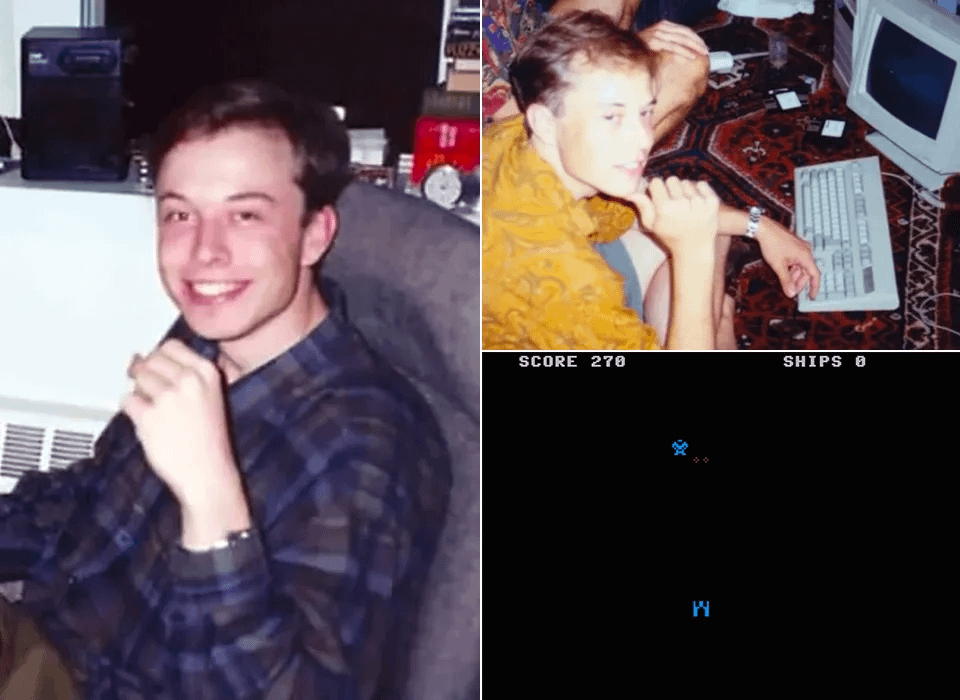
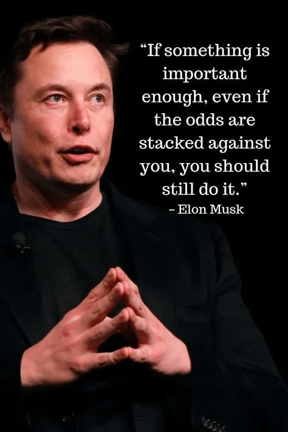
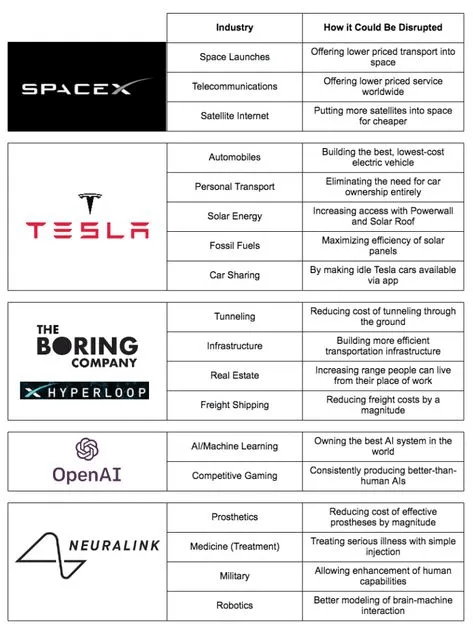
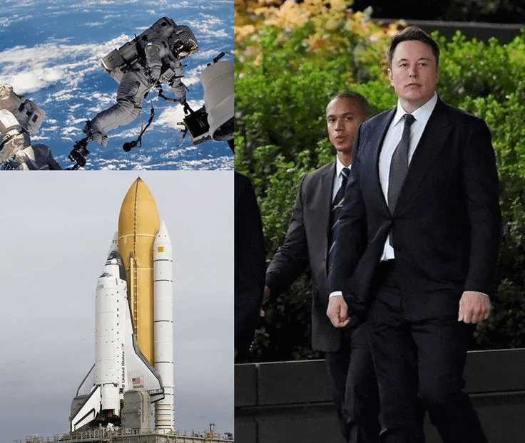

### 马斯克简介

> 马斯克那股顽强的动力源自他在南非的艰难童年。他属于自闭症谱系，童年时期还受到过工程师父亲埃罗尔·马斯克的虐待。马斯克通过沉浸于书籍中来逃避现实，甚至把百科全书从头到尾读了个遍。

<figure class="video"><video controls preload="none" playsinline src="https://cdn.jsdelivr.net/gh/zhouzhengjeff/zhouzhengjeff.github.io@cca264d5f188c0f9d9b538c1c7d78dbff7114933/assets/masike_1.mp4"></video><figcaption>马斯克简介1</figcaption></figure>

>
年轻的马斯克很早就展现出了编程的天赋。12岁时，他设计了一个太空主题的电脑游戏《Blastar》，并以500美元的价格出售了游戏代码。当别的孩子在玩体育活动时，马斯克却在钻研艾萨克·阿西莫夫的科幻作品，并自学了计算机编程。

<figure class="video"><video controls preload="none" playsinline src="https://cdn.jsdelivr.net/gh/zhouzhengjeff/zhouzhengjeff.github.io@cca264d5f188c0f9d9b538c1c7d78dbff7114933/assets/masike_2.mp4"></video><figcaption>马斯克简介2</figcaption></figure>

> 这种创新的驱动力早早成了马斯克的根基。对他而言，失败从来不是阻碍，而是通往成功的一块垫脚石。这种坚韧造就了他“快速失败，迅速学习”的思维方式，贯穿在他所有的公司里。

<figure class="video"><video controls preload="none" playsinline src="https://cdn.jsdelivr.net/gh/zhouzhengjeff/zhouzhengjeff.github.io@cca264d5f188c0f9d9b538c1c7d78dbff7114933/assets/masike_3.mp4"></video><figcaption>马斯克简介3</figcaption></figure>

> 童年时期的孤独和未确诊的自闭症使他对解决重大问题充满了急迫感。无穷无尽的好奇心和“第一性原理”的思维方式让他与众不同。

### 马斯克的做事规约

<aside>
💡

面对任何挑战，马斯克都遵循一个五步的工程流程：

1. 质疑现状；
2. 抓住核心；
3. 简化并优化；
4. 快速反馈循环；
5. 自动化，但要在前四步之后进行。

这就是为什么SpaceX能以其他公司十倍的速度制造火箭。只有身处一线的人才能做出最佳决策。在SpaceX，每位工程师都要编写自己负责的火箭部件代码。马斯克亲自监督制造过程，绝不会将关键环节外包。全面掌控和高度负责是不可妥协的。

</aside>

<figure class="video"><video controls preload="none" playsinline src="https://cdn.jsdelivr.net/gh/zhouzhengjeff/zhouzhengjeff.github.io@cca264d5f188c0f9d9b538c1c7d78dbff7114933/assets/masike_5.mp4"></video><figcaption>马斯克简介5</figcaption></figure>

马斯克著名的“永不休息”文化。员工在紧张的时间表下承受巨大压力，去实现看似不可能的任务。团队的健康和工作生活平衡通常是次要考虑。这种方式确实容易导致严重的精力透支，但对马斯克来说却非常有效：

重视尊重，而非取悦他人。马斯克认为，激励别人达到最佳状态是一种馈赠，而不是攻击。同理心有其必要，但对表现不佳的人“迁就”是个错误。

了解自己和内心的驱动力。马斯克的“北极星”是确保人类能够持续存续下去。他充分发挥自己的长处，并坦然接受自己的缺点。当你找到并忠于自己的人生使命时，就能激发出源源不断的精力和韧性。韧性、专注、不懈地追求目标。他的“第一性原理”思维方式和责任感为创业者提供了行动路线图。在马斯克的世界里，成功属于那些敢于梦想并为之全力以赴的人。

### 总结

> 埃隆·马斯克正走在实现目标的路上。他认为人类的意识是一种宇宙奇迹，使我们有机会将人类变为多星际文明。也许他会成功，也许不会。但我对他充满了由衷的敬意。你从这篇内容中得到的最大启发是什么？

